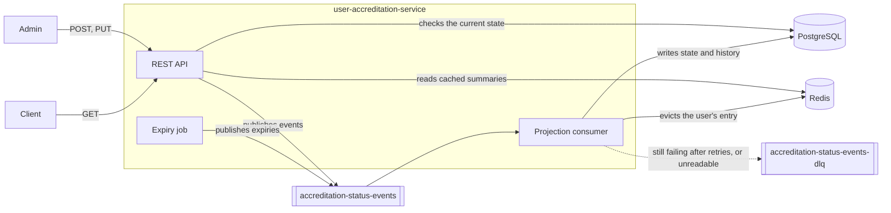

# User Accreditation Service

A REST service that keeps track of users' accreditation status. Administrators submit accreditations and decide on them; the client-facing app reads the current status. Every change is an event on Kafka, and a consumer projects the events into PostgreSQL, which serves the reads.

Built with Java 21 and Quarkus 3.40 (LTS), PostgreSQL 18, Kafka 4.4 (KRaft) and Redis 8.

## Running it

You need Docker with the Compose plugin, and `curl`. From the project root:

```bash
./run.sh
```

The script builds the service inside Docker, starts everything with `docker compose up --build -d` and waits until the service reports ready. The first build downloads the Maven dependencies, so it takes a few minutes.

| What | Where |
|---|---|
| Developer portal: documentation and Swagger UI | http://localhost:9999 |
| API | http://localhost:9999/api/v1 |
| Swagger UI | http://localhost:9999/q/swagger-ui |
| Kafka UI | http://localhost:8080 |
| Redis Insight | http://localhost:5540 |
| Prometheus | http://localhost:9090 |

PostgreSQL (5432), Redis (6379) and Kafka (9092) are published too, so these ports need to be free. `docker compose down` stops everything; add `-v` to drop the database as well.

All paths start with `/api/v1`, so the challenge's `POST /user/accreditation` is `POST /api/v1/user/accreditation` here.

## Using the API

| Method | Path | Used by | Success |
|---|---|---|---|
| `POST` | `/api/v1/user/accreditation` | admin | `202` with `{"accreditation_id": "…"}` |
| `PUT` | `/api/v1/user/accreditation/{accreditationId}` | admin | `202` with `{"accreditation_id": "…"}` |
| `GET` | `/api/v1/user/{userId}/accreditation` | client | `200`; `404` if the user has no accreditation |
| `GET` | `/api/v1/user/accreditation/{accreditationId}/history` | admin | `200` with every status change (not in the challenge) |

```bash
curl -i -X POST http://localhost:9999/api/v1/user/accreditation \
  -H 'Content-Type: application/json' \
  -d '{"user_id": "g8NlYJnk7zK9BlB1J2Ebjs0AkhCTpE1V", "accreditation_type": "BY_INCOME",
       "document": {"name": "2018.pdf", "mime_type": "application/pdf",
                    "content": "ICAiQC8qIjogWyJzcmMvKiJdCiAgICB9CiAgfQp9Cg=="}}'

curl -i -X PUT http://localhost:9999/api/v1/user/accreditation/<accreditation_id> \
  -H 'Content-Type: application/json' -d '{"outcome": "CONFIRMED"}'

curl -i http://localhost:9999/api/v1/user/g8NlYJnk7zK9BlB1J2Ebjs0AkhCTpE1V/accreditation

curl -i http://localhost:9999/api/v1/user/accreditation/<accreditation_id>/history
```

`POST` and `PUT` answer `202 Accepted`: the change is safely in Kafka when the response arrives, and the database shows it a moment later. A `GET` sent right after can still see the previous state, or `404` for a user's first accreditation.

The developer portal at http://localhost:9999 explains the lifecycle, the events, the limits and the metrics, and lets you try every endpoint. `postman/user-accreditation.postman_collection.json` has these requests, plus the business rules and the error cases, each with tests. Import it into Postman and run it against the running stack.

The rules:

- `PENDING` can become `CONFIRMED` or `FAILED`, and `CONFIRMED` can become `EXPIRED`. `FAILED` and `EXPIRED` are final. Any other change, including one to the current status, gets `409`, so a `PENDING` accreditation can't be expired through the API.
- A user can have only one `PENDING` accreditation; another submission gets `409`.
- A job expires `CONFIRMED` accreditations whose last update is more than 30 days old. It runs when the service starts and then every hour.
- Validation is strict. `user_id` is exactly 32 letters or digits, `mime_type` has to be `application/pdf`, and `content` has to be Base64 and at most 5 MB once decoded. Unknown or missing fields, wrong types and unknown values get `400`. I don't check that the file really is a PDF, because the sample content in the challenge isn't one.

Every error comes with the same body. `errors` is there only when validation fails:

```json
{
  "message": "Invalid request",
  "detail": "Some fields are missing or invalid. Please check them and try again.",
  "errors": [{"field": "user_id", "message": "must be exactly 32 letters or digits"}],
  "trace_id": "4bf92f35-77b3-4da6-a3ce-929d0e0e4736"
}
```

| Status | When |
|---|---|
| `400` | invalid body or path parameter, malformed JSON |
| `404` | unknown user, accreditation or URL |
| `405`, `406`, `413`, `415` | wrong method, an `Accept` other than JSON, a body over 8 MB, a body that isn't JSON |
| `409` | the user already has a `PENDING` accreditation, or the rules don't allow the status change |
| `429` | too many requests; `Retry-After` says when to try again |
| `503` | Kafka or PostgreSQL is unavailable; `Retry-After` here too |

The `trace_id` is also sent back in the `X-Request-Id` header and is on every log line of the request. The body never carries internal details; the real reason goes to the log.

## 9a. Architecture



The code is hexagonal (ports and adapters). The domain holds the state machine and the events, and depends on nothing else. The application layer holds the use cases and the ports they need. The adapters connect them to REST, Kafka, the scheduler, PostgreSQL and Redis.

Writes are event-first. For a submission, the API validates the request and checks the current state in PostgreSQL. It then stores the document and publishes an `ACCREDITATION_SUBMITTED` event, and answers once Kafka has acknowledged it. The consumer is the only writer to the database. In one transaction it skips events it has already applied, checks the rules again against the latest state, and writes the accreditation and a history row. After the commit it evicts the user's entry from the Redis cache. The client `GET` reads from that cache, or from PostgreSQL on a miss.

The topic is keyed by `user_id`, so all events of a user land on one partition and are applied in order. It keeps its records forever, because it is the audit log; the history table is the same log, queryable. An event has an id and type, the accreditation and user, the previous and new status, its origin (`ADMIN` or `SYSTEM_EXPIRY`) and its time. A submission event also carries a reference to the document: its id, name, type, size and SHA-256. The file itself stays in PostgreSQL and never goes through Kafka.

Patterns, briefly:

- hexagonal architecture
- event-driven, event-first writes
- CQRS-lite: the commands produce events and the read model is a projection of them
- the event log as the audit trail
- a single writer
- an idempotent consumer, deduplicating by event id
- optimistic concurrency: a compare-and-set on the status, plus `@Version`
- claim-check for the document
- retries with a dead-letter topic
- circuit breakers and rate limits
- cache-aside
- a correlation id from the request to the logs

## 9b. Concurrent updates by different administrators

The API checks the rules against the database, but by the time the event is applied that check can be out of date, so it is only a quick first answer. The decision is made by the consumer, the only writer. It checks every event against the latest state before writing it:

- A status change carries the status it was decided on, and it is applied only if the accreditation still has that status (compare-and-set).
- A submission is rejected if the user already has a `PENDING` accreditation.

Events are keyed by user, so they are applied one at a time and in order. Underneath, a partial unique index allows only one `PENDING` row per user, and `@Version` turns a lost update into an error. The stored state can't break the rules from 4).

What this doesn't do is tell the administrator who lost the race. Both requests got `202`; the second event is rejected by the consumer, logged as a warning and counted in `accreditation_projected_events_total{result="rejected"}`. If the answer itself has to be consistent, I would pick one of these:

1. Make the write synchronous. Check and update in one transaction with a conditional update on the expected status or version (`If-Match` and an ETag, with `412` for the loser). Publish the event through a transactional outbox.
2. Keep the flow asynchronous, but send commands rather than events to a topic partitioned by user. A single-writer command processor decides, and the API waits for its result by correlation id.

Either way, I would also accept an `Idempotency-Key` so a retried request can't be applied twice.

## 9c. Scaling the client-facing flow

- **Separate the deployments.** Run the same code as three processes, each scaled on its own: the client API, the admin API and the projection consumer. Client traffic then can't slow down the admin endpoints.
- **Scale the read path.** The client read already comes from Redis, which every instance shares and which the consumer evicts when a user's accreditations change. From there: more instances behind a load balancer, PostgreSQL read replicas for the cache misses, HTTP caching with ETags, and if needed a read model denormalized per user.
- **Scale the projection with partitions.** Add partitions and consumer instances, and watch consumer lag.
- **Move per-client limits to the gateway.** Per-client rate limiting and priority for admin traffic belong in an API gateway; the per-endpoint limits in the service are only a last line of defence.
- **Measure.** Use the Prometheus metrics, add tracing with OpenTelemetry, load-test with k6 or Gatling, and autoscale on latency and lag. Quarkus native images start fast, which helps when scaling out quickly.

## Failures and trade-offs

- **Retries and the dead-letter topic.** The consumer retries a failing event three more times, 2, 4 and 8 seconds apart, then moves it to `accreditation-status-events-dlq` with the reason in its headers. Unreadable messages go there straight away. An event rejected by the rules is not a failure: it is logged and counted, and doesn't go to the dead-letter topic.
- **Circuit breakers.** Kafka and PostgreSQL each have one. While a breaker is open, requests are turned away at once with `503` instead of waiting on a dependency that is down.
- **Rate limits.** Each admin endpoint accepts 10 requests a second and the client endpoint 100. The window is rolling, and rejected requests count too, so a client has to wait for `Retry-After`.
- **What a `503` from Kafka means.** When Kafka doesn't acknowledge an event, the producer gives up within a few seconds and the API answers `503` only after that, so the event isn't sent later behind the client's back. The one exception is a request the broker had already received but couldn't answer in time, which can still be written. A retry then gets `409`, and a `GET` shows the real state.
- **No automatic expiry for `PENDING`.** `PENDING` accreditations don't expire automatically, because the challenge asks this only for `CONFIRMED` ones.
- **Ordering after the dead-letter topic.** After a long outage, an event that went to the dead-letter topic can cause later events for the same accreditation to be rejected. The dead-letter topic has to be replayed first, in order.
- **Orphaned documents.** If publishing fails after the document is stored, the document is left without an accreditation; a cleanup job would remove such documents.
- **Several instances.** The expiry job skips overlapping runs only within one instance. With several instances, the consumer's compare-and-set makes a duplicate expiry harmless; clustered Quartz would avoid the duplicate run.
- **Single-node Kafka.** Kafka runs as a single node with a replication factor of 1. That's fine for running locally, but not for production.
- **Times.** Times are shown in Europe/Malta time with the offset of the day (`+01:00` in winter, `+02:00` in summer). PostgreSQL stores them as instants (`timestamptz`).

## Observability

- **Logs.** Every log line of a request has its `trace_id`; every log line of the consumer has the event and accreditation ids.
- **Metrics.** `/q/metrics`, scraped by Prometheus, shows:
  - `accreditation_submissions_total`, `accreditation_finalizations_total` and `accreditation_expiries_total`
  - `accreditation_projected_events_total{result, reason}`
  - `accreditation_dead_lettered_events_total{reason}`
  - HTTP, JVM and Kafka client metrics
  - the retry, circuit breaker and rate limit metrics of SmallRye Fault Tolerance
- **Health.** `/q/health/ready` reports whether PostgreSQL, Redis and Kafka can be reached; `run.sh` waits on it.

## Tests

```bash
./mvnw verify
```

This needs JDK 21 and Docker. Testcontainers starts PostgreSQL and Redis, and Quarkus starts a Kafka broker.

- **Unit tests.** The domain and the services are tested with in-memory fakes.
- **Integration tests.** The endpoints, the consumer (retries, the dead-letter topic), the expiry job, the cache, the circuit breakers and the rate limits are tested with `@QuarkusTest` against real containers.

## AI usage

I built this with AI-driven development, using Claude Code. We started with a long conversation that turned the challenge into a detailed plan, and then wrote the code in small steps, each following part of that plan. I reviewed and tested every change myself before committing it.
